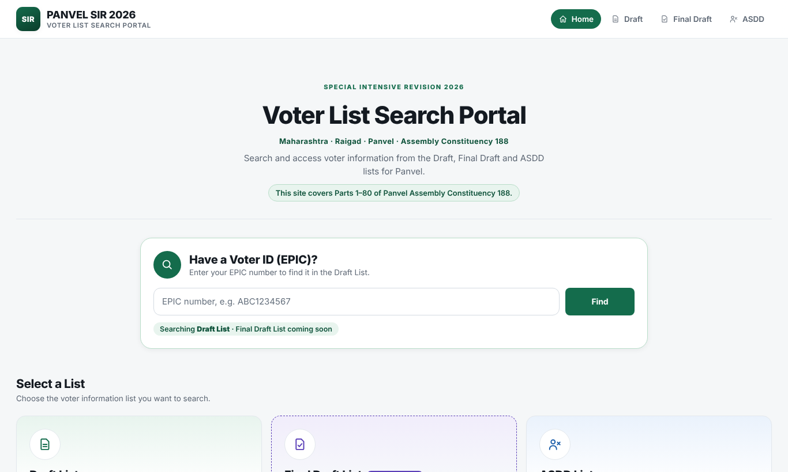
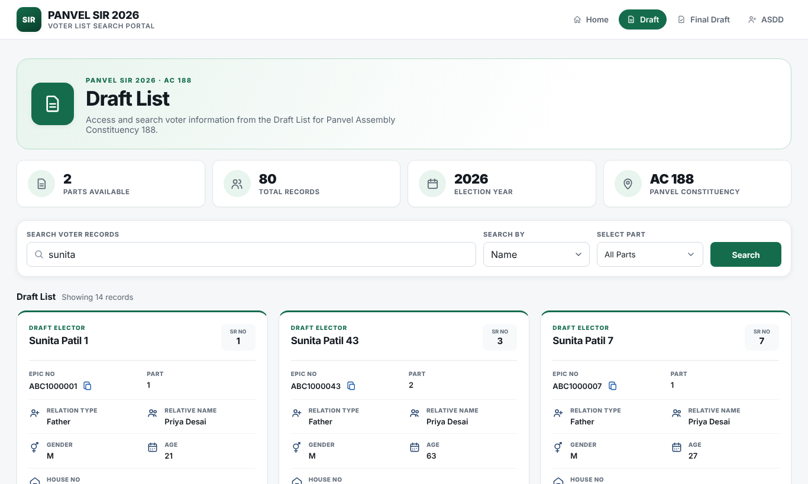
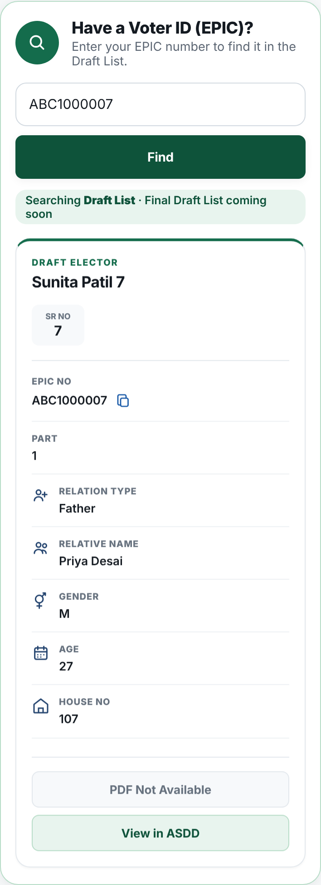

# Panvel SIR 2026 — Voter List Search Portal

A fast, mobile-first search portal for the **Special Intensive Revision (SIR) 2026** voter lists of
**Panvel Assembly Constituency 188** (Raigad, Maharashtra). Voters can find their entry by name or
EPIC number and open the exact page of the official PDF with their entry highlighted.

**Live:** [sir.hamzapatel.co.in](https://sir.hamzapatel.co.in) · **Built by:** [Hamza Patel](https://hamzapatel.co.in)

> Unofficial lookup tool. Covers Parts 1–80. Official corrections are made only at
> [voters.eci.gov.in](https://voters.eci.gov.in) (Form 8).

| Home | Search | EPIC finder (phone) |
|---|---|---|
|  |  |  |

*Screenshots use generated test data, not real voters.*

---

## Features

- **Three lists:** Draft, Final Draft ("Coming soon" until published) and ASDD (Absent, Shifted, Dead & Duplicate).
- **Forgiving name search:** word-by-word, any order, plus common Indian spelling variants
  (`hamja` → `hamza`, `patil` ↔ `patel`, `md` → `mohammad`, `w/v`, `ee/i`…).
- **EPIC finder on Home:** searches the newest published list and always says which list it searched.
- **In-site PDF viewer:** opens the voter's exact page with a box around their entry, on phones too
  (Android Chrome ignores `#page=` links). Loads only the bytes of that page via HTTP Range requests.
- **Removal / correction requests:** contact form → Telegram, protected by Cloudflare Turnstile and a rate limit.
  Admins can hide an EPIC from every public search in one click.
- **Private admin:** imports (Excel + PDFs), dataset versions and publishing, on a separate Worker behind Cloudflare Access.

## Architecture

```
Browser ──► Firebase Hosting (React + Vite SPA, sir.hamzapatel.co.in)
   │
   └──► panvel-sir-api  (Cloudflare Worker, read-only, CORS-locked, rate-limited)
            ├─ D1: draft · final · asdd   (SQLite + FTS5 full-text search)
            ├─ R2: original PDFs          (streamed with byte ranges)
            └─ /api/contact ──► Turnstile check ──► Telegram bot

Admin ──► Cloudflare Access (login) ──► panvel-sir-admin (Worker: admin UI + import API)
                                            └─ same D1 + R2
```

## Engineering notes (built entirely on free tiers)

| Constraint | Decision |
|---|---|
| D1 free: 5M rows read/day | Every lookup uses a forced index (`INDEXED BY`); no "list everything" page; no `COUNT(*)` pagination — cursor-based "Load more" instead. A v4 duplicate-EPIC check that read **3.06M rows per import** was rewritten to negligible reads. |
| D1 free: 100k rows written/day | Dropped 4 unused indexes → **5 writes per record**; imports are resumable per Part, so a failed upload never re-writes finished Parts. |
| Scraping risk (personal data) | Origin lock, per-IP rate limit, 3-letter minimum for name search, max 30 results per request, no bulk endpoints, no public data files. |
| Admin security | Separate Worker; Cloudflare Access **and** in-code JWT verification (`jose`), so admin stays locked even if Access is misconfigured. |
| Speed on budget phones | Self-hosted font, API preconnect, Analytics loaded after paint, admin code excluded from the public bundle, 5-minute browser cache + 60-second in-Worker cache for list metadata. |

### PageSpeed Insights (sir.hamzapatel.co.in)

| | Before | After |
|---|---|---|
| Mobile performance | 78 | **98** |
| First Contentful Paint (mobile) | 3.5 s | **1.2 s** |
| Largest Contentful Paint (mobile) | 4.3 s | **2.3 s** |
| Desktop performance | 97 | **99** |
| Accessibility / Best practices / SEO | 95 / 100 / 92 | **100 / 100 / 100** |

## Tech stack

React 19 · TypeScript · Vite · React Router · PDF.js — Cloudflare Workers · D1 (SQLite, FTS5) · R2 · Access · Turnstile —
Firebase Hosting · Google Analytics 4 · Vitest

## Repository layout

```
web/   React website (public build → Firebase; admin build → admin Worker)
api/   Cloudflare Workers: public API (src/index.ts) and admin (src/admin-worker.ts)
       migrations/  D1 schema    test/  unit tests
```

## Run locally

Requirements: Node.js 20+, a Cloudflare account for `wrangler`.

```bash
# API (local D1/R2, no live quota used)
cd api
npm install
cp .dev.vars.example .dev.vars
npx wrangler d1 migrations apply panvel-sir-draft --local   # repeat for -asdd and -final
npm run dev                     # public API on :8787
npm test

# Website
cd ../web
npm install
npm run dev                     # http://localhost:5173 (proxies /api to :8787)
```

Admin locally: `npm run dev:admin` in `api/` (Access is skipped only on localhost with `ACCESS_DEV_BYPASS=1`).

## Data & privacy

- **No voter data is in this repository** — no Excel, PDF, JSON exports or database files.
  Data lives only in Cloudflare D1/R2 and is uploaded through the private admin.
- The contact form stores nothing; requests are forwarded to the site owner on Telegram.
- People can ask for their entry to be hidden from searches on the site.

## License

Code: [MIT](LICENSE). The electoral roll data shown on the live site is not part of this repository and is not covered by this license.
